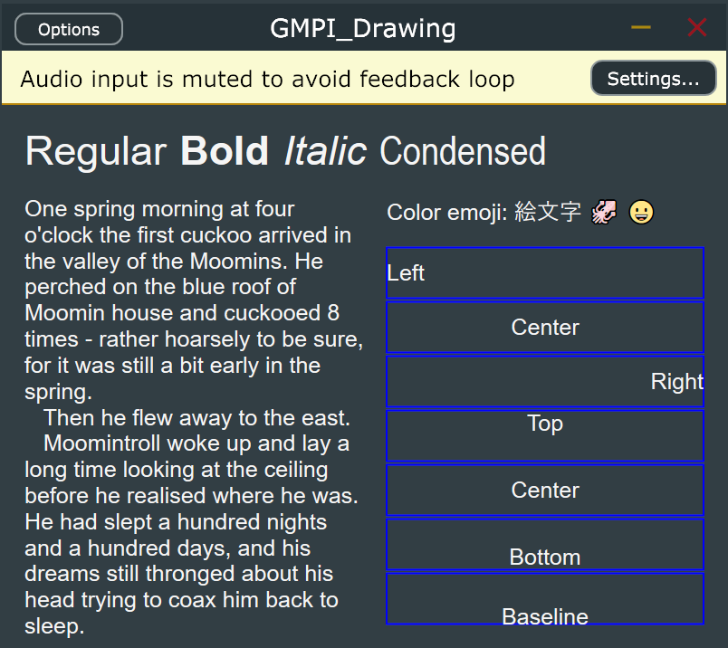
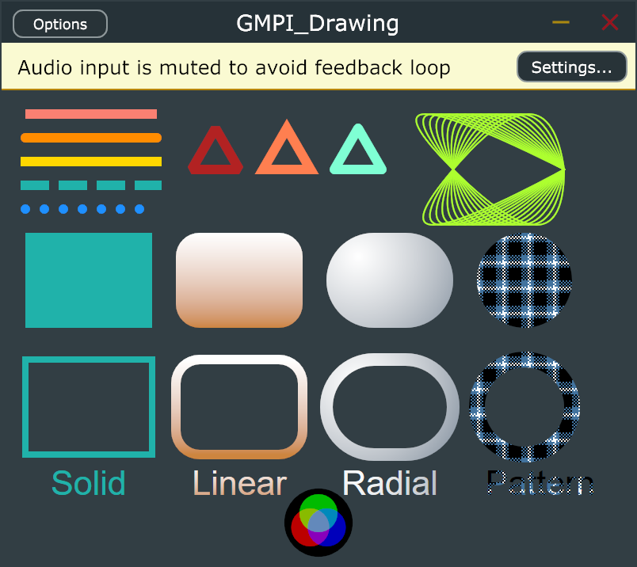

# GMPI-Drawing

A cross-platform drawing library for Windows, macOS and Linux which is lightweight and can be used in a shared library, which makes it a good fit for audio plugin GUIs.

For JUCE projects there is also a backend that renders through juce::Graphics (see `backends/JuceGfx.h`), which additionally supports any platform JUCE runs on.




# Features

GMPI Drawing:
* Has a permissive open-source license
* An open standard. No fees, contracts or NDAs
* Has cross-platform support (Windows, macOS and Linux)
* The native backends need nothing but the standard OS features and the standard C++ library
* A clean and bloat-free API surface
* Provides all APIs in both C++ and in pure portable 'C' for maximum compatibility
* Uses the platforms native drawing (Cocoa / Direct-2D) to minimise overhead and build times.
* Optional GPU backend (Direct3D 12 / Metal / Vulkan) with custom shader brushes
* Optional JUCE backend (juce::Graphics) for use inside JUCE projects and on other platforms
* Text in any languages via UTF-8
* Color emojis
* Bitmap images
* Vector paths with lines, bezier curves, and arcs
* Solid, gradient, and tiled image fills
* Rotation, scaling and translation
* DPI aware

# Backends

Every backend implements the same API. The Direct2D, software and GPU backends are tested against the same Direct2D reference images ([gimpi_ui_tests](https://github.com/JeffMcClintock/gimpi_ui_tests)), so a GUI draws the same whichever of them it gets.

| Backend | Source | Platforms | |
|---|---|---|---|
| Direct2D | `backends/DirectXGfx.h` | Windows | the default on Windows |
| CoreGraphics | `backends/CocoaGfx.h` | macOS | the default on macOS |
| Software | `backends/CpuGfx.h` | all | the default on Linux (X11 and Wayland); text through `helpers/CpuTextEngine.h` (HarfBuzz) |
| GPU | `backends/GpuGfx.h`, `backends/gpu/` | Windows, macOS, Linux | opt-in, see below |
| JUCE | `backends/JuceGfx.h` | anywhere JUCE runs | |

## GPU backend

`backends/GpuGfx.h` draws through gmpi_ui's own GPU renderer (`backends/gpu/`, absorbed from [Visage](https://github.com/VitalAudio/visage)) over a vendored subset of [bgfx](https://github.com/bkaradzic/bgfx): Direct3D 12 on Windows, Metal on macOS, Vulkan on Linux. Like the Direct2D and software backends it works in premultiplied linear half-float, and it draws text with the software backend's text engine.

It is opt-in. Build it into a target with

```cmake
include(${GMPI_UI_SDK}/backends/gpu/gmpi_gpu.cmake)
target_link_libraries(my_target PRIVATE gmpi_gpu)
target_compile_definitions(my_target PRIVATE GMPI_UI_GPU_BACKEND=1)
```

then ask for it at run time: `GMPI_UI_GPU=1` in the environment, or `gmpi::gpugfx::hostPreference()` from the host's own settings (the environment variable, 1 or 0, overrides the preference). Frames built with `GMPI_UI_GPU_BACKEND` then present through it: the Windows native-window frame (`DxDrawingFrameHwnd`), macOS (`DrawingFrameMac`), X11 and Wayland. A machine that cannot run the renderer keeps the default backend.

It also offers an extension the other backends answer `NoSupport` to: shader brushes, whose colour comes from a fragment shader the module supplies (`GmpiApiShaders.h`).

Building, shaders and tests: [backends/gpu/README.md](backends/gpu/README.md).
