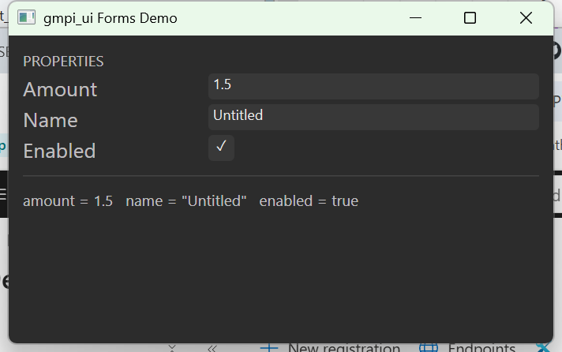

# FormsDemo

A standalone desktop app built from gmpi_ui's widget set and nothing else: a
window, a `gmpi::ui::Form`, and three controls - a number entry, a text entry
and a tick box - wired the way SynthEdit's PropertiesBrowser wires its rows
(`SynthEditLib/EditorLib/PropertiesBrowser.cpp`).



What it demonstrates:

* **A page of rows.** `Page` stacks rows, `LabeledRow` gives each a label
  column, and `Heading` marks a section.
* **One-way editors.** Each editor is given the model's value and a function
  that receives the user's edit, which the form validates before committing.
  The editor keeps showing the model's value, so `abc` typed into the number
  entry is simply rejected, and `1.50` over `1.5` counts as no change.
* **Rebuild on change.** `Body()` re-runs whenever the model changes
  (`invalidateView()`), and when the bounds or the theme do; the summary line is simply rebuilt.
* **An immutable model with undo/redo.** `Model` is a plain value; every
  committed edit appends a new one to an `immer::vector` (a persistent
  structure from [immer](https://github.com/arximboldi/immer), fetched by
  CMake), so each version is a cheap independent snapshot. A cursor into that
  vector is the current version: Undo/Redo (buttons, or ctrl+Z / ctrl+Y) move
  it, and a commit after an undo drops the redo tail. The history IS the
  undo stack - no command objects, no inverse operations.

Files:

| | |
| --- | --- |
| `DemoForm.h/.cpp` | the Form: model, undo history, `Body()` |
| `MainWin32.cpp` | the shell: an overlapped HWND hosting gmpi_ui's Direct2D `DrawingFrame` |

## Building

Windows only for now (Win32 + Direct2D). GMPI is taken from a sibling
checkout (`../../../GMPI`) when there is one, else fetched from GitHub;
`-DGMPI_SDK_FOLDER_OVERRIDE=<path>` points it elsewhere. immer is always
fetched (header-only, pinned to a release tag in `CMakeLists.txt`).

```
cmake -S . -B build -G "Visual Studio 18 2026" -A x64
cmake --build build --config Debug
build\Debug\FormsDemo.exe
```
